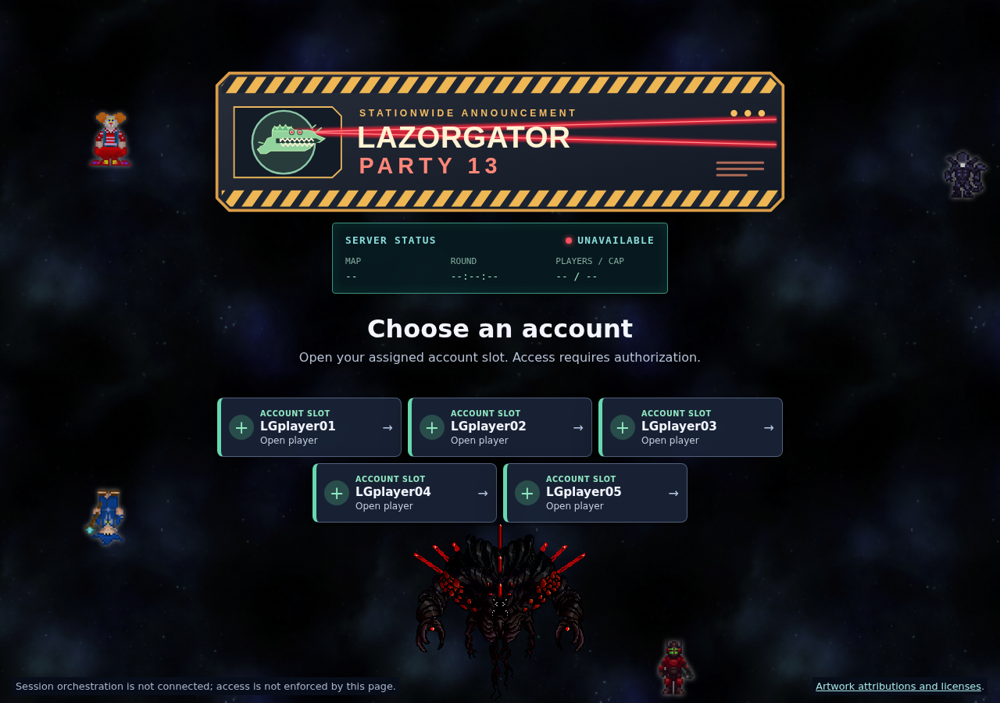
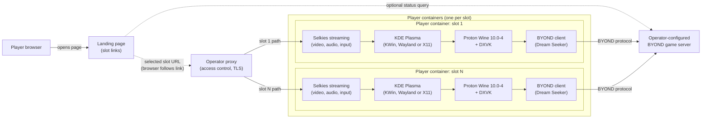

# tgstation-gateway

<p align="center">
  <a href="https://github.com/flashdim/tgstation-gateway/actions/workflows/ci.yml"></a><br>
  
  
  <br>
  <a href="https://www.docker.com/"></a>
  <a href="https://github.com/selkies-project/selkies"></a>
  <a href="https://www.byond.com/"></a>
  <a href="https://github.com/Kron4ek/Wine-Builds"></a>
</p>

The repository currently provides an experimental single-player BYOND image, an optional landing-page prototype and a fixed-slot manager. The player streams the screen and audio; it does not host a game server or dynamically assign browser sessions, and a complete authenticated gameplay session has not been verified.


## Architecture



The game server is outside this repository. The optional landing page returns
slot URLs; the dashed arrow shows the browser following a selected URL to the
proxy. The page does not forward the player connection. The proxy routes each
slot path to its player container. Its status query is separate from gameplay,
and the player image works without the landing page. The optional slot manager
registers routes with Traefik; alternatively, an operator proxy can route slots
directly. Access control and TLS remain the operator's responsibility.

## Run the player

You need Docker Compose and an internet connection to download the image. From the repository directory, run:

```sh
docker compose -f examples/compose.yaml pull
docker compose -f examples/compose.yaml up
```

Open [http://localhost:8080](http://localhost:8080) for the player.
The default setup opens the BYOND pager; sign in and choose a server.
If the image is not available from GHCR yet, build it locally as described below.

The image uses Selkies' EGL KDE Plasma desktop with KWin on Wayland by
default. Set `SELKIES_WAYLAND=false` when running Compose to compare with
Plasma on X11/Xvfb.
In Wayland mode, BYOND starts once Plasma shares its authenticated XWayland
display with the gateway's launcher.
Compose disables gamepad, microphone, and webcam forwarding by default. It
selects H.264 and allows Selkies to use an available GPU for rendering and
encoding; the GPU Compose override passes through `/dev/dri`. The container
does not receive Bluetooth hardware or the host system bus, so Bluetooth is
unavailable in this setup.
To test the published development image explicitly in Wayland mode, run:

```sh
GATEWAY_IMAGE=ghcr.io/flashdim/tgstation-gateway:dev SELKIES_WAYLAND=true \
  docker compose -f examples/compose.yaml up --pull always
```

Press **Ctrl+C** to stop the running container. To remove it and its temporary player data, run:

```sh
docker compose -f examples/compose.yaml down
```

The Compose example mounts the host's `/etc/localtime` read-only so the
container uses the host's date, time and timezone. Set `TZ` (for example
`TZ=Europe/Berlin`) to override the timezone. On hosts without
`/etc/localtime`, remove that volume and set `TZ`.

## Test landing page

The optional landing-page prototype runs as a separate localhost-only Compose
service. Build the image locally from the repository root:

```sh
docker build -f landing/Dockerfile -t tgstation-gateway-landing:local .
```

Compose defaults to `ghcr.io/flashdim/tgstation-gateway-landing:latest`.
Before the first release, or to try the latest CI build, select the development
image with `GATEWAY_LANDING_IMAGE=ghcr.io/flashdim/tgstation-gateway-landing:dev`.
To use the image built locally, set
`GATEWAY_LANDING_IMAGE=tgstation-gateway-landing:local`. Then
`docker compose -f examples/compose.yaml --profile landing up` starts the landing
page with the player; without `--profile landing` it is not started. Open [http://localhost:8000](http://localhost:8000), or set
`GATEWAY_LANDING_PORT` to choose another host port.

The landing server validates slot configuration at startup and generates
`slots.js` from an in-memory lifecycle snapshot on each request; no
configuration file is mounted. Compose passes these variables through:

| Variable                 | Default                           | Meaning                                                                        |
| ------------------------ | --------------------------------- | ------------------------------------------------------------------------------ |
| `GATEWAY_PLAY_HOST`      | `localhost:${GATEWAY_PORT:-8080}` | DNS name, with optional port, that serves player sessions                      |
| `GATEWAY_PLAY_SCHEME`    | see below                         | `http` or `https`; defaults to `http` for localhost, else `https`              |
| `GATEWAY_SLOT_COUNT`     | `1`                               | Number of slots, 1–99                                                          |
| `GATEWAY_ACCOUNT_PREFIX` | `LGplayer`                        | Slot accounts are the prefix plus a two-digit number (`LGplayer01`)            |
| `GATEWAY_SLOT_PATH`      | `/`                               | URL path per slot; `{account}` and `{number}` are substituted                  |
| `GATEWAY_DEPLOYMENT_ID`  | `local`                           | Stable deployment identity; use a unique value per deployment on a Docker host |
| `GATEWAY_QUERY_HOST`     | empty                             | Game server DNS name or IPv4 address, as seen by the landing container         |
| `GATEWAY_QUERY_PORT`     | empty                             | Game server BYOND port, 1–65535                                                |

Set both query variables to enable the game status panel. These identify the
DreamDaemon game server, not the player-streaming host in `GATEWAY_PLAY_HOST`
or the TGS API. For example, set `GATEWAY_QUERY_HOST=game.example.org` and
`GATEWAY_QUERY_PORT=1337` in the Compose environment. The landing container
must be able to reach that host and TCP port. `localhost` refers to the landing
container itself, not the Docker host. Leave both empty to disable querying.

The panel polls the tgstation `?status` World Topic using the MIT-licensed
`byond-wire` 0.1.2 client, whose wheel and hash are pinned. The query
does not need BYOND or TGS credentials. A valid response shows the map,
connected clients, round time, and the reported `popcap` (∞ if zero, `?` if
absent).
The cap is tgstation's maximum of its configured soft, hard, and extreme
thresholds, not necessarily a strict connection limit. Time is unavailable
before the round starts. Errors, invalid replies and stale data show
**unavailable**, not offline. A successful response proves only that the
status query answered, not that joining or gameplay works. Compatibility with
the operator's actual game build remains to be verified.

For example, to list two slots at `https://play.lazorgator.party/LGplayer01/`
and `https://play.lazorgator.party/LGplayer02/`:

```sh
GATEWAY_PLAY_HOST=play.lazorgator.party \
GATEWAY_SLOT_COUNT=2 \
GATEWAY_SLOT_PATH='/{account}/' \
GATEWAY_DEPLOYMENT_ID=my-gateway \
docker compose -f examples/compose.yaml --profile landing up
```

With more than one slot, `GATEWAY_SLOT_PATH` must contain `{account}` or
`{number}` so each slot has a distinct link. Prefixes contain 1–24 ASCII letters,
digits, `_` or `-`. Paths permit ASCII letters, digits, `.`, `_`, `~`, `/`, `-`
and the two placeholders; `.` and `..` segments, repeated slashes, percent
encoding, query strings and fragments are rejected. These checks validate the
landing configuration, not requests to the proxy. The landing page only builds
these links; a proxy must route each path to the corresponding player
container. The example Compose file runs one player, so
only a single-slot configuration reaches a working player without additional
routing. Fixed deployments require paths ending in `/`. Invalid values stop
the landing container at startup with an error naming the variable. Startup
logs list each generated slot URL.

### Fixed account containers

The fixed deployment starts one player per configured account, without creating
or deleting containers on browser connections. For example:

```sh
export GATEWAY_SLOT_COUNT=2 GATEWAY_SLOT_PATH='/{account}/'
export GATEWAY_PLAY_HOST=play.example.org GATEWAY_DEPLOYMENT_ID=my-gateway
export BYOND_SERVER=game.example.org:1337
export GATEWAY_FIXED_LANDING=1
umask 077
tmp=$(mktemp /tmp/gateway-compose.XXXXXXXX)
if python3 examples/fixed-slots.py > "$tmp" &&
  mv "$tmp" /tmp/gateway-compose.json; then
  docker compose -f /tmp/gateway-compose.json up -d --remove-orphans
else
  rm -f "$tmp"
  echo "Generation or replacement failed; existing deployment was not changed." >&2
fi
```

The generator requires Docker Engine 28 or newer and Docker Compose, and uses the player settings in
`examples/compose.yaml` and requires an operator-configured `BYOND_SERVER`.
Each account receives a separate service, Wine and
data volumes, bridge network and loopback port: `GATEWAY_PORT` (default 8080) for slot 01,
then consecutive ports. It rejects port overflow and a landing-port collision.
The optional landing service is included when `GATEWAY_FIXED_LANDING=1`.
To include the existing GPU override, set `GATEWAY_FIXED_GPU=1` and
`DRI_RENDER_GID` to the host render-node group ID before generating.
Keep `GATEWAY_DEPLOYMENT_ID` stable and unique per deployment; it determines the
Compose project. Re-generate the file and run the same `up` command when
changing configuration or count. `--remove-orphans` removes old services in
that Compose project only. Do not share that project with unrelated services
or override its name with `COMPOSE_PROJECT_NAME` or `-p`. When reducing the
count, removed accounts' volumes remain; inspect and remove them separately
when their data is no longer needed.

Containers use Docker's `unless-stopped` restart policy. Docker restarts an
exited container and, when the daemon starts, restarts containers that were not
manually stopped. A manual stop persists across daemon restarts; an unhealthy
but running container is not restarted by this policy. Removing a container
externally also requires another `up`. The example sets 4 GiB memory, two CPUs,
512 PIDs and 2 GiB shared memory per player; these are not measured recommendations. Monitor
startup and health and ensure sufficient host resources and Docker bridge address
pools for all slots. `docker compose -f
/tmp/gateway-compose.json down` stops the deployment but retains the named
account volumes. `down -v` deletes volumes declared in the current configuration,
but not necessarily orphan volumes from earlier configurations. Deletion is not
secure erasure. Treat volumes, container layers and backups as sensitive.

#### Managed slots behind Traefik

`examples/compose.traefik.yaml` starts the landing page and a slot manager.
The manager creates one persistent player container per slot, registers its
route using Traefik Docker labels, and reconciles missing or stopped
containers. Traefik terminates HTTPS and routes `/LGplayer01/` and subsequent
slot paths directly to their corresponding players. No gateway ports are
published. Players start asynchronously; check manager logs and player health
before use.

**The generated Traefik routes do not authenticate or authorize users.**
Anyone who reaches them can control every slot and access its persistent
data. Cloudflare proxying alone is not authentication. Protect every landing
and player route with an external access boundary and prevent direct-origin
bypasses. A middleware on the landing route alone does not protect player
routes; apply the boundary to all paths, for example on the Traefik
entrypoint. This example connects the landing and player containers to the
existing `public` network so they can resolve
`tgstation`. **Any container on that network can also connect directly to
player streams**, bypassing Traefik. Use it only with trusted containers and
operators; Docker and host administrators can also reach the backends.
Traefik-to-backend traffic is HTTP. For Cloudflare-to-origin protection, use
Full (strict) with a valid Traefik certificate.

**The manager has unrestricted Docker daemon access**, equivalent to host root.
It is a privileged component, not a player-accessible API. Only the manager
mounts the Docker socket; the landing page and player containers do
not. Do not mount that socket in other services or use this deployment on an
untrusted Docker host.

From a repository checkout, with Docker Compose 2.23.1 or newer and an existing
`public` network shared by Traefik and the BYOND server:

```sh
export GATEWAY_PLAY_HOST=www.lazorgator.party
export GATEWAY_TRAEFIK_NETWORK=public GATEWAY_TRAEFIK_ENTRYPOINT=https
export GATEWAY_DEPLOYMENT_ID=tgportals
export GATEWAY_SLOT_COUNT=4
export BYOND_SERVER=tgstation:1337
export GATEWAY_QUERY_HOST=tgstation GATEWAY_QUERY_PORT=1337
# Use the development tags if a latest release is not available.
export GATEWAY_IMAGE=ghcr.io/flashdim/tgstation-gateway:dev
export GATEWAY_LANDING_IMAGE=ghcr.io/flashdim/tgstation-gateway-landing:dev
export GATEWAY_MANAGER_IMAGE=ghcr.io/flashdim/tgstation-gateway-manager:dev
docker compose -f examples/compose.traefik.yaml up -d
docker compose -f examples/compose.traefik.yaml ps --all
docker compose -f examples/compose.traefik.yaml logs manager
docker ps -a --filter label=io.tgstation-gateway.deployment=tgportals
```

`GATEWAY_QUERY_HOST` and `GATEWAY_QUERY_PORT` are optional and control the
landing page's status panel. Set the image variables to the desired release or
PR development tags. Keep `GATEWAY_DEPLOYMENT_ID` unique and stable: it names
the Compose project, Traefik route and persistent account volumes. It must
contain 1–48 lowercase letters, digits, underscores or hyphens and start with
a letter or digit. Do not override the Compose project name with `-p` or
`COMPOSE_PROJECT_NAME`, run multiple managers for the same deployment, or
reuse a project belonging to another deployment. The manager defaults to
`ghcr.io/flashdim/tgstation-gateway-manager:latest`; select `:dev` or
`:dev-pr83` for a development build. To update an existing tag, pull the
manager image and recreate the manager container. Set these variables in the
shell or a Compose `.env` file, not just in the landing container's environment.

Remove the old `tgstation-landing` Traefik labels or stop that deployment
before enabling the new routes: two routes for the same host can conflict.
Traefik's Docker provider must discover the landing and player containers on
the shared network. Its certificate, HTTPS redirects and access-control
middleware remain operator responsibilities. If updating a previous PR
version that ran a Caddy router, stop and remove that old router container;
otherwise its orphaned route can intercept landing traffic. For a dedicated
Compose project, `docker compose -f examples/compose.traefik.yaml up -d
--remove-orphans` removes the old Compose router, but can also remove other
orphan services in that project. Inspect them before using it.

Set `GATEWAY_SLOT_COUNT` to 1–99 and rerun `docker compose ... up -d` after
changing it. The manager removes extra owned containers but retains their Wine
and data volumes until those slots are configured again. It
refuses containers or volumes with conflicting ownership labels. Changing the
BYOND server, player image, network, hostname or Traefik entrypoint recreates
the affected player containers.
To update an existing image tag, pull it first and restart the manager.
**Every manager startup removes and recreates all configured owned players and
erases their Wine and data volumes**, including volumes left behind by missing
containers. This interrupts active sessions and permanently deletes saved
logins, settings and player data. It also applies to automatic manager restarts
after failures and host/daemon restarts; a failed startup can leave a partially
reset deployment. Host password files are read-only and are not erased. Unowned
containers and volumes are rejected, not deleted. Subsequent reconciliation
passes only start stopped players or recreate missing or changed ones, retaining
their volumes until the next manager startup.
Managed players use WebSocket mode, the project's seccomp profile, and fixed
resource limits. Container startup does not establish playable sessions.

To opt into BYOND pager login automation, place one UTF-8 password per file
in a protected host directory, named `LGplayer01_password.txt`,
`LGplayer02_password.txt`, and so on. An optional final LF or CRLF is ignored.
Replace the old keys override and `_key.txt` files; the launcher no longer
copies `key.txt`. Use the development player and manager images from the
same revision when testing this change.

```sh
export GATEWAY_SECRET_DIRECTORY=/absolute/host/path/to/byond-passwords
docker compose -f examples/compose.traefik.yaml \
  -f examples/compose.traefik.passwords.yaml up -d
```

Use the passwords override for subsequent Compose commands (and the GPU override
too, if enabled). The directory is mounted read-only into the manager at the
same absolute path; Docker resolves each player bind mount on the daemon host.
Use a local daemon and keep the path identical there; the path cannot contain
commas, double quotes or newlines. The manager validates all
configured files before reconciling, then mounts only the matching file
read-only into each player. `BYOND_PASSWORD_FILE` contains only the mount
path and `BYOND_ACCOUNT` identifies the slot's account. Files must be nonempty
regular files owned by UID 1000 with mode `0400` or `0600`; symlinks and
hard links are rejected. Directory traversal
permissions, ACLs, user namespace remapping and remote daemons need
separate operator validation. Protect the directory and its parents against
untrusted modification; validation and Docker mounting are not atomic.
Docker metadata exposes host paths. Do not put passwords in environment
variables, command lines, Compose files, images, logs or caches. The desktop
and pager run as UID 1000 and can read the slot's password file, so use only
dedicated accounts in trusted desktops. Restrict access to each slot.

The launcher still sets BYOND's `userpath` to `C:\users\steamuser\Documents\BYOND\`.
It looks for the English login dialog owned by the pager it starts, fills
the account and password, checks **Save password** and **Automatically login
when program starts**, and submits at most once per pager launch. An
unrecognized dialog or rejected login needs manual intervention. Real BYOND
login has not been verified. Treat Wine prefixes and backups as sensitive.
To rotate a password, stop the manager, replace the file, and start the manager
with the same overrides. This resets all configured player volumes.

For a standalone player, mount only its password file read-only at
`/run/secrets/byond_password.txt` and set `BYOND_PASSWORD_FILE` to that path
and `BYOND_ACCOUNT` to the intended account. Neither variable is needed for
manual login.

For managed players, Docker health checks the Selkies endpoint, not Dream
Seeker. This lets Traefik route to the desktop even if the BYOND pager needs
interactive login or the game client has stopped. A healthy slot does not
prove that BYOND has launched or connected. If Selkies becomes unhealthy,
Traefik may route the slot URL to the landing page's 404 instead.

For an Intel/AMD GPU available through `/dev/dri` on the Docker daemon host,
enable optional player GPU access with the GPU Compose override:

```sh
docker compose -f examples/compose.traefik.yaml \
  -f examples/compose.traefik.gpu.yaml up -d
```

The override enables `GATEWAY_MANAGER_GPU` and bind-mounts `/dev/dri` read-only
into the manager for group-ID detection; it does not grant the manager GPU
device permissions. With exactly one render node, `DRI_RENDER_GID` is detected
automatically. If no render node or multiple render nodes are present,
the manager exits with an explicit error unless you set `DRI_RENDER_GID`
in the shell or Compose `.env` file. Obtain that override with
`stat -c '%g' /dev/dri/renderD128`, using your intended GPU's render node.
The manager passes `/dev/dri:/dev/dri` and that supplementary group to
every player, not to the landing container. GPU access is disabled
by default. Changing the GPU setting or group ID requires a manager restart,
which recreates configured players and erases their volumes as described above.
Enabling it requires `/dev/dri` on the daemon host;
Compose refuses a missing bind-mount source rather than creating it.
Use both Compose files for subsequent GPU deployment commands.
This exposes all host DRI devices to
players and increases their access to the host graphics driver. It does not
provide NVIDIA Container Toolkit support or guarantee DXVK compatibility;
check player logs and health after enabling it.

The manager-created player containers and their named volumes are **not**
Compose services or Compose-managed volumes. `docker compose down` stops the
manager and landing page but does **not** stop or remove the players; `down -v` does
not delete their data. Inspect and deliberately stop/remove them and their
volumes separately when no longer needed. Their volume names differ from the
`fixed-slots.py` deployment; no account data is migrated automatically.

The generated Traefik middleware strips cookies, authorization and known
Cloudflare Access credential headers before forwarding, but does not validate
them. Before sharing access, verify your external authorization, direct-origin
restrictions, all slot routes, WebSocket reconnects and gameplay. Integration
tests use mock backends; real Cloudflare, media and gameplay remain unverified.

#### Recovery and operator cleanup

Use the same Docker context, deployment ID, account prefix and other settings
as the original deployment. Save the generated configuration securely outside
`/tmp` if it is needed after a reboot; it contains host paths and settings. The
generation command above writes to a temporary file and replaces the previous
file only on success. Never run `up` after a failed generation. Inspect
`docker compose -f /tmp/gateway-compose.json config` and `docker compose -f
/tmp/gateway-compose.json ps -a` before applying changes. Re-run the generation
and `up -d --remove-orphans` command above to recreate missing services, start
manually stopped ones, or apply a reviewed configuration. Inspect `ps -a` and
service logs afterward. A failed `up` can leave a partially changed deployment:
diagnose the error, restore the intended settings and rerun `up`; Compose does
not roll back automatically.

`--remove-orphans` removes containers for services no longer in that Compose
project, not just gateway-labelled containers. Ensure the project is dedicated
to this deployment before using it. Changing the deployment ID creates a
different project rather than recovering the old one; changing the account
prefix creates different account volumes. Reducing the count removes the extra
services but retains their Wine and data volumes. Increasing it again with the
same deployment ID and prefix reuses those volumes, including any previous
login. Before assigning an account to someone else, stop its service and
explicitly handle both volumes and any backups according to your data policy.

To find volumes, use the project name in the generated file and run
`docker volume ls --filter label=com.docker.compose.project=<project>`. Inspect
the current account mounts with `docker inspect` on the corresponding container
and `docker volume inspect <volume-name>`; retain an inventory of account-to-volume
names before reducing the count or changing the prefix. Orphans are not listed
in the new service configuration. For a still-configured account, remove its
stopped container with `docker compose -f /tmp/gateway-compose.json rm -s
player01` (substitute the intended service) before removing its volumes.
After verifying the exact volume names, backups and that no container uses
them, remove only the intended volumes with `docker
volume rm <wine-volume-name> <data-volume-name>`. Do not use global volume prune.
`down -v` is a destructive project-wide operation, not a way to select an
individual account. Protect Docker access from players and other untrusted users.

For a **disposable test host**, record the deployment ID, container IDs, both
volume names and separate non-sensitive markers in each account's Wine and data
volumes, plus an unrelated deployment and its marker. Test a service process
exit, an explicit stop, an unhealthy service, external container removal and
repeated `up`. Then restart the Docker daemon and separately reboot the host.
After each, inspect `ps -a`, health and logs; check that non-stopped services
return, stopped services remain stopped until `up`, each marker stays with its
account, and the unrelated deployment is unchanged. Check count reduction,
restoration and deliberate removal of selected orphan volumes as well. Do not
restart the daemon or host on a shared production system just to run this test.
Daemon/host restart and real browser disconnect/reconnect have not been verified
by the fixture tests. For the latter, disconnect and reconnect an authenticated
browser on a test deployment and check the same container and BYOND process
remain; record the result separately from startup or gameplay checks.

The landing page lists configured account links, not occupancy or health. With
the external-proxy deployment, the operator must route each generated path to
the matching loopback port and enforce authenticated ownership **before** routing,
including WebSockets and any viewer access. An account name or path alone is
not proof of ownership. Protect the landing page and direct player ports; do
not expose Docker or unauthenticated streams to players.

#### Two-account nginx example

`examples/nginx-fixed-slots.conf` is an optional external boundary for the
two-account configuration above, using nginx HTTP Basic authentication over
TLS. It maps `/LGplayer01/` to loopback port 8080 and `/LGplayer02/` to
8081, with a separate password file per account. The fixed-slot generator
sets each player's `SELKIES_SUBFOLDER` to its configured path; nginx must pass
the prefix through unchanged. The example uses `SELKIES_MODE=websockets`;
WebRTC is not covered. The proxy does not manage containers or expose Docker.

Before enabling it, the operator must:

1. Use the fixed deployment settings shown above with the default account
   prefix and ports (`GATEWAY_PORT=8080`), and keep `SELKIES_MODE=websockets`.
   Adapt **every** nginx location, port, account and password file if those
   settings change. Do not leave an old route enabled after reassignment.
2. Install nginx on the Docker host. Configure a valid certificate and private
   key at the paths in the example, replace **both** `play.example.org`
   occurrences with the public DNS name, and ensure the nginx master can read
   the key. Include the example server block in nginx's `http` configuration.
   Configure certificate renewal and test with `nginx -t` before reload.
3. Create `/etc/nginx/gateway/LGplayer01.htpasswd` and
   `/etc/nginx/gateway/LGplayer02.htpasswd` with `htpasswd -c -B FILE USER`,
   entering a distinct strong password interactively for each. Each file must
   contain **only** the identity or identities explicitly authorized for that
   account; anyone in that file can control or view that desktop. Do not reuse
   credentials across accounts. Protect the directory, files and backups while
   allowing nginx workers to read the password files. Never commit them.
4. Ensure no other nginx virtual host, proxy, host listener, firewall rule,
   Docker network or forwarded port exposes either backend. The example
   deliberately returns 404 for other paths and does not serve the landing
   page; protect the landing separately if it is published. Only trusted
   administrators and processes may access loopback, the Docker daemon or
   container networks. Docker port publishing and host firewall rules must be
   verified for IPv4 **and** IPv6 on the actual host.

Basic authentication is only one possible external implementation, not a
requirement to use nginx or a particular identity provider. The example
authenticates all paths under each slot, including assets, API requests,
WebSocket upgrades and viewer traffic; it removes the Basic credential before
forwarding and disables nginx access logs. Protect and review error logs too:
do not record credentials, tokens, query strings or player data. The default
Selkies same-origin WebSocket protection must not be relaxed. `#shared` is a
browser-side viewer selection, not a secret or an authorization decision;
viewing still requires access to the account, and anyone authorized for that
account can also open its controller.

This Basic-auth example is not compatible with WebKit browsers that omit
Basic credentials from WebSocket handshakes: nginx will reject their streams.
Selkies' own Basic-auth socket cookie does not authenticate to nginx. Use a
separately verified external cookie-based authentication boundary if those
browsers are required; do not bypass authorization for upgrades.

The integration test `python3 -m unittest discover -s tests -p test_fixed_proxy.py`
requires nginx and OpenSSL; it otherwise skips. It exercises this configuration
over TLS with two instrumented mock backends, including denied cross-account,
forged-header, unknown-host, traversal and WebSocket requests. It does not
prove host firewall isolation or live media. In a disposable local check of the
pinned Selkies 2.2.1 base image with `/LGplayer01/`, nginx served the page,
manifest, JavaScript and health endpoint, rejected an unauthenticated upgrade,
and forwarded an authenticated `/api/websockets` upgrade (101); a disallowed
browser Origin was rejected (403). The missing-slash path returned 404, not a
redirect. This does not verify the full player image, viewer behavior, media
or gameplay. Recheck all paths, redirects and browser requests on the actual
deployment after changing Selkies, proxy or transport settings.

#### External boundary verification

Before granting player access using an external proxy, the operator must select
and configure a TLS and authorization boundary. Bind player and landing ports only
to loopback, restrict host and Docker access, and ensure the boundary is the
only player-accessible route. Loopback does not protect against other users or
processes on the Docker host. The boundary must authenticate every request,
map a trusted identity to its assigned account, and authorize that account
before forwarding HTTP, WebSocket upgrades and viewer access. Reject unknown
accounts and paths. Do not accept client-supplied identity headers, account
names or session IDs as proof; remove or overwrite such headers at the
trusted boundary. Configure TLS and certificate renewal there.

On a disposable deployment with two distinct test identities and two player
slots, verify the operator's actual boundary before use:

1. Confirm each identity reaches only its assigned slot over HTTPS and that
   the intended WebSocket upgrade and stream use the same authorization.
   Verify the proxy's path rewriting and the browser's actual requests, not
   just the landing links.
2. Try unauthenticated, expired and cross-account requests, unknown paths,
   forged identity headers and WebSocket upgrades. They must be rejected
   before reaching either player endpoint; use non-sensitive backend request
   counts or equivalent evidence to verify this. Repeat for viewer access.
3. From an untrusted network, try direct player and landing ports, including
   applicable IPv4 and IPv6 addresses. Confirm they cannot bypass the boundary.
   Check host firewall and proxy configuration as well as Compose bindings.

Record the proxy, identity provider, transport, versions, configuration and
results without recording credentials or player data. These remain operator
acceptance checks for the actual deployment. A passing HTTP check
alone does not verify streaming or a WebSocket authorization decision.

Stock Selkies uses a three-second reconnect grace for a disconnected display,
not a timeout for a connected but inactive user. Viewers can keep a shared
capture running; teardown may be delayed by other connections. Neither the
container nor BYOND is deleted on disconnect. The desktop **Reset Session**
shortcut remains a deliberate manual restart. Real disconnect/reconnect
behavior and gameplay still require manual verification.

On a test deployment, record the image and BYOND versions, browser, display
mode, transport and timestamps for each observation separately:

| Manual check                                                                                  | Result in this project             |
| --------------------------------------------------------------------------------------------- | ---------------------------------- |
| Authenticated BYOND login and joining the configured server                                   | Not verified                       |
| Browser stream, input, audio and game-scene/WebView rendering                                 | Not verified as a complete session |
| Disconnect and reconnect before and after the grace period; same container and BYOND process  | Not verified                       |
| A second authorized viewer stays connected while the controller disconnects, then disconnects | Not verified                       |
| Two simultaneous accounts, server-reported IP/computer IDs and ban enforcement                | Not verified                       |

For disconnect tests, record observed timings and capture behavior, not just
container health. Repeat with and without a viewer; do not assume that the
documented grace period guarantees a particular teardown time. Separately
record actual gameplay results and failures; fixture, startup and health checks
do not establish login, streaming, viewing or playability.

#### Fixed-slot acceptance audit

On 2026-11-25, the fixed-slot tests were run locally against Docker Engine
28.0.4 and Compose 2.38.2 with the pinned Alpine fixture: 16 tests passed.
They exercised two distinct read-only key mounts, separate Wine and data
volumes, inter-slot connectivity rejection, process restart, recreation,
count changes, invalid configuration, a failed service addition, selected
volume cleanup and an unrelated fixture deployment. Capacity and resource
limits were checked as configuration, not under load. The fixture replaces
the player image and removes published ports; these results do not verify
BYOND, browser access or direct-port protection.

The local nginx/OpenSSL proxy test also passed against two mock backends. It
checked that unauthorized and cross-account HTTP and WebSocket requests,
including a simulated viewer URL, did not reach either backend. It did not
test a real viewer, media stream, host firewall or the operator's boundary.
These fixture results are separate from startup and health smoke tests.

The acceptance criteria in [#56](https://github.com/flashdim/tgstation-gateway/issues/56)
remain open. Closed issues #61–#68 and merged PRs #73 and #76 are historical
implementation records, not evidence that the manual checks passed. The
outstanding audit is tracked in [#78](https://github.com/flashdim/tgstation-gateway/issues/78);
do not close it without follow-up issues for unresolved checks and a report
on #56. In particular, actual boundary and direct-bypass verification, live
Selkies reconnect/viewer timing, daemon and host restart, real credential
rotation and cleanup, and resource exhaustion remain unverified. Complete
real login and gameplay verification first, as required by the roadmap, and
record the environment and results separately from the fixtures.

For credential rotation on a disposable deployment, record non-sensitive
markers in both accounts' volumes, stop the intended service, replace its password file,
and recreate that service as described below. Verify only the intended
account receives the replacement, its data persists, and the other account
is unchanged; do not log credentials. For resource exhaustion, use a
disposable host with bounded test workloads and monitoring; record the
triggered limit, service and host behavior, retained data and recovery after
restoring capacity. Do not intentionally exhaust a shared or production host.
Neither procedure has been verified against the player image.

Optionally set `GATEWAY_SECRET_DIRECTORY` to an absolute, protected host
directory containing a nonempty `<account>_password.txt` for every slot. The
generator mounts only the matching file read-only and sets `BYOND_ACCOUNT`
and `BYOND_PASSWORD_FILE`. Files must be owned by UID 1000 with mode
`0400` or `0600`. Final symlinks and hard
links are rejected. Protect parent directories from untrusted changes and keep
files stable until containers stop; validation and Docker mounting are not
atomic. User namespace remapping and remote daemons require separate permission
validation. Match passwords to accounts manually; never store credentials in
environment values, command lines, images, logs or build caches. Docker
metadata contains the host paths. To rotate a password, stop its service,
replace the source file, and recreate it with Compose. BYOND may reuse its
previous saved login without opening the dialog; sign out if needed.

The fixed account volumes retain login and desktop data across container
recreation. Never reassign an account's data to a different person without an
explicit operator-controlled cleanup.

The image prefix is initialized at build time and then copied into each new
Wine volume. Consequently, any machine identifiers, registry values, or
login state present in that template would also be cloned. The build installs
BYOND without operator credentials; this has not established that Wine or
BYOND generates unique machine/computer IDs per clone or that every possible
login artifact is absent. Do not build or cache a prefix used for a real
login. Compare two fresh clients and inspect the server's reported IDs and ban
behavior before deployment; shared IPs or cloned identities may collide.
Never alter identifiers to evade bans. Results and any compatibility issues
remain unverified.

See `landing/assets/ATTRIBUTION.md` for artwork sources and licenses.
The landing image publishes `dev` for main-branch CI builds and `dev-pr<number>`
for same-repository pull requests. Releases publish a version tag matching the
release and `latest` for non-prereleases. CI development tags are pushed before
image validation and may refer to a build that later fails validation.

## Connect directly to a server

To request a connection to a server through the BYOND pager, provide its address and port:

```sh
BYOND_SERVER=server.example.org:1337 docker compose -f examples/compose.yaml up
```

At each client startup, the launcher sets `auto-login off` in BYOND's
`cfg/pager.txt` and `graphics-hwmode on` and `guest-login off` in
`cfg/seeker.txt`, retaining other settings. It starts the pager with the server
URL; the pager is expected to log in and launch Dream Seeker. Without a configured
password, BYOND may require interactive pager login. A BYOND account or
server-side authentication may still be required. Automatic login and joining
through the pager have not yet been verified against a real server. In
direct-server mode, the healthcheck still requires a Dream Seeker process; it
does not prove login or gameplay.

## Customize the session

The panel pins only **Reset Session**. Use it to stop BYOND and Wine so the
supervised client can restart. Each service launch first stops the Wine
server for its prefix, then terminates and checks for remaining BYOND and
WebView2 processes owned by the container user. This also covers processes reparented
after a client exits. Cleanup is serialized, and the launcher refuses to
start BYOND if it cannot confirm shutdown. Because the process cleanup is
user-wide rather than prefix-specific, do not run unrelated BYOND or WebView2
sessions as the same user in the player container.

WebView2 runs multiple browser and renderer processes for BYOND's embedded
web interfaces; their presence during a session is expected and disabling
them may break those interfaces. To verify cleanup with a real game, record
the WebView2 PIDs and memory use, reset repeatedly via the shortcut and
browser reconnect, and confirm old PIDs disappear while new interfaces work.
This has not yet been verified in a real gameplay session.

The system tray scales icons with panel height
and always shows audio volume. Clipboard, Camera Indicator, Disks & Devices,
Keyboard Layout, Lock Keys Status, Disk Quota, Input Method, Media Player,
Notifications, Trashcan, and Weather Report are disabled. The digital clock is
also present in the panel. Tray preferences are applied to the Plasma 6 system
tray containment at login.

Fresh Plasma sessions use Breeze Dark colors, a dark Plasma theme, Breeze
window decorations, dark icons and Breeze cursors. The bottom panel is
centered, fits its contents, dodges application windows, is opaque and
non-floating, and is 64 pixels high. Its task manager displays window labels
with icons and pins Reset Session. These are first-run defaults; the shortcut
and tray settings are reapplied at login.
Other changes made in Plasma remain in the session's user configuration,
which is discarded with the container.

The defaults are installed in `/etc/xdg/kdeglobals`, `/etc/xdg/plasmarc`
and `/etc/xdg/kcminputrc`. The first-run panel and wallpaper layout is
`/usr/share/plasma/look-and-feel/org.kde.breezedark.desktop/contents/layouts/org.kde.plasma.desktop-layout.js`.
Operators can mount
replacement configuration files read-only before starting a fresh container,
or change the appearance and panel in Plasma. If selecting a different global
look-and-feel, its own first-run layout may replace the gateway panel layout.

The first-run desktop uses a Plasma slideshow of the images in
`landing/assets/wallpapers/`, including **Glory to Nanotrasen** by **partheosis** and
the **Space Station 13** logo by **Wirewraith**. See `landing/assets/ATTRIBUTION.md` for
sources and licenses (also installed at
`/usr/share/tgstation-gateway/wallpaper-attribution.md` in the image).
Images are centered at their original size against a black background. This
first-run default applies to fresh containers; existing Plasma settings are not
overwritten. Plasma's default slide interval is 15 minutes. To add
images to the built-in collection, place them in `landing/assets/wallpapers/`, record
their attribution and license, and rebuild the image.

To replace the collection without rebuilding, bind-mount an operator-supplied
directory of images read-only at `/usr/share/tgstation-gateway/wallpapers`
before starting a fresh container.
For example, add this under the Compose player's `volumes`:

```yaml
- /absolute/path/to/wallpapers:/usr/share/tgstation-gateway/wallpapers:ro
```

### Desktop verification

The layout and panel properties were queried in fresh **desktop-only** test
containers based on the pinned Selkies image, in both X11 and Wayland.
Screenshots, the wallpaper slideshow, and the BYOND window's geometry and
usability while the panel dodges windows have **not** been manually
verified in the complete player image. To verify, start a fresh container in
each display mode, capture the desktop and panel before and while an
application window overlaps the panel, verify that the slideshow changes
images, then connect to a test server and
capture the game window with the panel dodging it. Record the image digest,
display mode, screenshots and any failures separately from startup or health
checks.

Selkies follows the browser's display size by default. Common stream and
display settings can be overridden with `SELKIES_MODE` (default `websockets`;
set `webrtc` to use WebRTC instead),
`SELKIES_FRAMERATE` (default `60`),
`SELKIES_VIDEO_BITRATE`, `SELKIES_AUDIO_BITRATE`, `SELKIES_ENABLE_RESIZE`, and
`SELKIES_SCALING_DPI`.

The WebSocket default has not yet been verified through a reverse proxy in an
interactive session. WebRTC may require additional network
configuration; an HTTP reverse proxy alone does not necessarily carry its media.

To use a fixed size:

```sh
SELKIES_MANUAL_WIDTH=1280 SELKIES_MANUAL_HEIGHT=720 \
  docker compose -f examples/compose.yaml up
```

The Selkies interface title and sidebar controls can be overridden with the
`SELKIES_UI_*` settings in `examples/compose.yaml`. File transfers and printing
default to disabled (`SELKIES_FILE_TRANSFERS=none` and
`SELKIES_PRINTING_ENABLED=false`).

Change the local web address port with `GATEWAY_PORT`, for example `GATEWAY_PORT=8081`.

## Build locally

To build the image from this repository and use it with Compose:

```sh
docker buildx build --load --platform linux/amd64 -t tgstation-gateway-player .
GATEWAY_IMAGE=tgstation-gateway-player docker compose -f examples/compose.yaml up
```

The package layer upgrades available OS packages, removes selected applications
and unneeded dependencies, and installs the pinned Wine packages. The upgrade
fails if it would need to remove packages; the Wine pins must remain available
in the Ubuntu repositories. Package versions depend on repository state at
build time. Use `--no-cache` when rebuilding to refresh the package layer;
Docker may otherwise reuse an older layer.
The Selkies-patched KWin packages are held at the base image's versions to
preserve its Wayland compositor; dependent packages may also be kept back.
Update the pinned base image to refresh them.
The unused Steam apt sources are removed with the Steam launcher.

The image uses checksum-pinned standalone Proton Wine 10.0-4 as its active
runtime. Ubuntu Wine 10 packages supply runtime dependencies; Wine's executable
comes from the Proton archive. Graphics setup runs BYOND's bundled DirectX
installer and verifies its `d3dx9_43.dll` against the bundled CAB. Graphics
setup also installs checksum-verified DXVK 3.1.1.

At runtime, all Wine debug channels (including errors) are disabled with
`WINEDEBUG=-all`. Selkies logs and launcher error messages remain visible.
Build-time Wine errors are still logged.

## Important limitations

- This is an early experiment. Fixed account containers and their persistent data are not yet verified with real gameplay or authenticated routing.
- BYOND rendering and gameplay are not fully verified. A successful start does not guarantee that every game or interface will work correctly.
- The example is bound to your local machine. The browser stream is not protected by default; do not expose it directly to the internet. Arrange your own access controls and secure connection if you need remote access.

See the [roadmap](ROADMAP.md) for planned work and known gaps.
